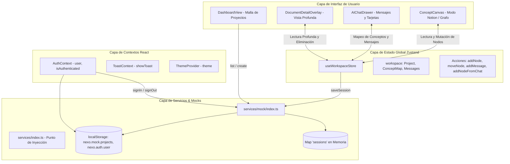

# Auditoría Exhaustiva del Frontend — Nexo Desktop

**Fecha:** 15 de Octubre de 2026  
**Auditor:** Principal Software Architect, Senior Frontend Engineer & API Integration Specialist  
**Proyecto:** Nexo Desktop (`nexo-desktop`)  
**Repositorio:** `git@github.com:KevinTimaran/Nexo_Frontend.git`  
**Rama:** `main` (Sincronizada con `origin/main`)  
**Commit base:** `35d40b5`  

---

## 1. Resumen Ejecutivo

Nexo Desktop es una aplicación de escritorio diseñada para la ideación, exploración conceptual asistida por inteligencia artificial y mapeo visual de conocimientos. El objetivo de esta auditoría es evaluar con rigor técnico la base de código real del frontend, contrastar las funcionalidades implementadas frente a las simuladas o ausentes, mapear los modelos de dominio y flujos de estado, y determinar con precisión empírica los requisitos que un futuro backend debe satisfacer.

### Hallazgos Principales:
1. **Frontend Moderno y Compilación Limpia:** El proyecto está construido sobre **React 19.1.0, TypeScript ~6.0.3, Vite 8.0.16, Tailwind CSS 4.3.3, Zustand 5.0.15 y React Router DOM 7.18.4**, ejecutándose dentro de un contenedor **Tauri v2**. La compilación de producción (`npm run build`) se ejecuta exitosamente con cero errores y advertencias de TypeScript.
2. **Entorno Tauri Básico:** La integración nativa con Rust en `src-tauri` es mínima; actualmente solo expone el comando estándar `greet` y el plugin `opener`. No existen plugins de almacenamiento seguro (`@tauri-apps/plugin-store`), persistencia local en SQLite ni comandos IPC dedicados a seguridad.
3. **Persistencia Simulada y Pérdida de Datos:** Proyectos creados persisten en el `localStorage` del navegador (`nexo.mock.projects`), y la sesión de usuario en `nexo.auth.user`. Sin embargo, el estado del lienzo conceptual (nodos y relaciones) y los mensajes de conversación de un proyecto modificado residen exclusivamente en un `Map` en memoria (`sessions`) dentro de `src/services/mock/index.ts`. Estos datos no sobreviven a un reinicio completo de la aplicación.
4. **Firma de Persistencia Síncrona:** El contrato de servicio `WorkspaceService.save(projectId, map, messages): void` es síncrono y de tipo *fire-and-forget*, lo cual es incompatible directamente con llamadas HTTP asíncronas a un backend sin una refactorización de su firma o un mecanismo reactivo de debounce/autosave en Zustand.
5. **Acoplamiento Directo a Mocks:** Múltiples componentes (`useWorkspaceStore.ts`, `AuthContext.tsx`, `DashboardView.tsx`, `WorkspaceView.tsx`, `AppLayout.tsx`) importan de forma acoplada `mockServices` directamente desde `src/services/mock` en lugar de consumir la interfaz unificada expuesta en `src/services/index.ts`.
6. **IA Basada en Heurísticas Léxicas:** El servicio de IA actual (`AIService.reply`) simula respuestas mediante expresiones regulares (`RISK_WORDS`, `VIABILITY_WORDS`) y retardos artificiales (`latency(1600)`), generando nodos con fases fijas (`planning`, `execution`, `validation`), explicaciones simplificadas y acciones de mapeo al lienzo.
7. **Ausencia de Pruebas Automatizadas y Configuración de Entorno:** No existen archivos de variables de entorno (`.env`, `.env.example`) ni dependencias para pruebas unitarias o E2E (Vitest, Jest, Playwright).

---

## 2. Estructura Real del Repositorio

La estructura del código fuente está organizada bajo una arquitectura modular orientada a funcionalidades (`features`), compartiendo componentes transversales, modelos de dominio y capas de servicio:

```text
nexo-desktop/
├── .gitignore
├── .vscode/
├── Cargo.lock
├── Cargo.toml
├── dist/                          # Salida de compilación Vite
├── index.html                     # Entrypoint HTML con viewport y metadatos
├── package.json                   # Dependencias y scripts
├── PLAN_REFACTORIZACION.md        # Registro histórico de mejoras UI/UX
├── README.md                      # Plantilla genérica de Vite + Tauri
├── src/
│   ├── App.tsx                    # Enrutamiento principal y proveedores globales
│   ├── main.tsx                   # Punto de entrada React (StrictMode, createRoot)
│   ├── vite-env.d.ts              # Tipado de Vite
│   ├── app/
│   │   └── providers/
│   │       └── ThemeProvider.tsx  # Proveedor de tema (light, dark, system)
│   ├── components/
│   │   ├── layout/
│   │   │   ├── AppLayout.tsx      # Estructura Shell con Titlebar, Sidebar y Outlet
│   │   │   ├── Sidebar.tsx        # Navegación lateral con proyectos recientes
│   │   │   └── Titlebar.tsx       # Barra de título personalizada para Tauri (drag region)
│   │   ├── navigation/
│   │   │   └── CommandPalette.tsx # Paleta de comandos global (Cmd+K / Ctrl+K)
│   │   └── ui/
│   │       ├── Badge.tsx          # Píldoras de estado y tipos de concepto
│   │       ├── Button.tsx         # Botón estándar con variantes y estado loading
│   │       ├── Input.tsx          # Campo de texto accesible con iconos y errores
│   │       └── Modal.tsx          # Diálogo accesible con focus trap y Escape
│   ├── context/
│   │   ├── AuthContext.tsx        # Contexto de sesión de usuario y persistencia local
│   │   └── ToastContext.tsx       # Sistema flotante de notificaciones toast
│   ├── domain/
│   │   └── types.ts               # Modelos de datos del dominio e interfaces TypeScript
│   ├── features/
│   │   ├── auth/
│   │   │   ├── LoginView.tsx      # Pantalla de inicio de sesión
│   │   │   └── ProtectedRoute.tsx # Guardia de rutas con redirección preservada
│   │   ├── dashboard/
│   │   │   ├── CreateProjectModal.tsx # Modal para nuevo proyecto
│   │   │   └── DashboardView.tsx  # Malla de proyectos, búsqueda y filtros de estado
│   │   ├── documents/
│   │   │   └── GenerateDocumentModal.tsx # Generador y visor Markdown de resumen ejecutivo
│   │   ├── settings/
│   │   │   └── SettingsModal.tsx  # Modal de preferencias (tema, idioma, accesibilidad)
│   │   └── workspace/
│   │       ├── AIChatDrawer.tsx   # Panel lateral de conversación con IA y tarjetas
│   │       ├── AddNodeModal.tsx   # Modal de creación manual de conceptos
│   │       ├── ConceptCanvas.tsx  # Lienzo dual (Modo Notion y Modo Grafo Bezier)
│   │       ├── DocumentDetailOverlay.tsx # Visor profundo de documentos de nodo
│   │       ├── NodeInspectorSheet.tsx # Inspector lateral de nodo en modo grafo
│   │       └── WorkspaceView.tsx  # Orquestador del espacio de trabajo
│   ├── i18n/
│   │   ├── index.ts               # Inicialización de i18next (es, en)
│   │   ├── i18next.d.ts           # Aumentación de tipos para i18n
│   │   └── locales/
│   │       ├── en/translation.json # Diccionario inglés
│   │       └── es/translation.json # Diccionario español
│   ├── mocks/
│   │   └── seed.ts                # Proyectos semilla bilingües y plantillas IA
│   ├── services/
│   │   ├── contracts.ts           # Interfaces abstractas de servicios
│   │   ├── index.ts               # Punto de inyección de servicios (mockServices)
│   │   └── mock/
│   │       └── index.ts           # Implementación en memoria y localStorage
│   ├── store/
│   │   └── useWorkspaceStore.ts   # Tienda global Zustand para lienzo, nodos y chat
│   ├── styles/
│   │   └── index.css              # Tailwind v4, tokens de diseño y glassmorphism
│   └── theme/
│       └── tokens.ts              # Mapeo de tokens de diseño
├── src-tauri/
│   ├── Cargo.toml                 # Dependencias Rust (tauri v2, serde, opener)
│   ├── build.rs                   # Script de compilación Tauri
│   ├── capabilities/
│   │   └── default.json           # Permisos de ventana y plugins Tauri
│   ├── src/
│   │   ├── lib.rs                 # Handler de comandos Rust (greet)
│   │   └── main.rs                # Entrypoint de la aplicación Tauri
│   └── tauri.conf.json            # Configuración de ventana (1280x820), títulos y CSP
└── tsconfig.json                  # Configuración TypeScript estricta
```

---

## 3. Pila Tecnológica Verificada

| Componente | Tecnología | Versión | Estado en el Repositorio |
|---|---|---|---|
| **Núcleo UI** | React | `^19.1.0` | Verificado en `package.json` |
| **Lenguaje** | TypeScript | `~6.0.3` | Modo estricto verificado con `noUnusedLocals: true` |
| **Empaquetador** | Vite | `^8.0.16` | Configurado en `vite.config.ts` (puerto 1420) |
| **Contenedor Desktop** | Tauri | `^2.0` | CLI v2 y API v2 verificados en `src-tauri` |
| **Estilos y Diseño** | Tailwind CSS | `^4.3.3` | `@tailwindcss/vite` con tokens Apple HIG |
| **Enrutamiento** | React Router DOM | `^7.18.4` | Enrutamiento declarativo con rutas protegidas |
| **Gestión de Estado** | Zustand | `^5.0.15` | Tienda centralizada en `useWorkspaceStore.ts` |
| **Internacionalización** | i18next / react-i18next | `^26.4.2` / `^17.0.16` | Bilingüe (`es`, `en`) con cambio en caliente |
| **Iconografía** | Lucide React | `^1.49.0` | Iconos vectoriales consistentes en toda la app |
| **Utilidades CSS** | clsx / tailwind-merge | `^2.1.1` / `^3.7.0` | Composición de clases dinámicas |
| **Cliente HTTP** | *Ninguno* | — | **Ausente**: No existe `axios` ni cliente `fetch` |
| **Pruebas** | *Ninguno* | — | **Ausente**: Sin frameworks de testing instalados |

---

## 4. Auditoría Pantalla por Pantalla y Flujos de Usuario

### 4.1 Pantalla de Autenticación (`/login`)
- **Archivo principal:** [`src/features/auth/LoginView.tsx`](file:///home/kevin/Universidad/Dise%C3%B1o%20de%20interfaces/Proyectos/AppPc/Nexo_Frontend/nexo-desktop/src/features/auth/LoginView.tsx)
- **Propósito:** Permitir al usuario ingresar credenciales para acceder a la aplicación de escritorio.
- **Componentes clave:** `LoginView`, `Input`, `Button`, `Sparkles`, `ShieldCheck`.
- **Interacciones de usuario:**
  - Ingreso de correo y contraseña.
  - Alternar visibilidad de contraseña (`Eye` / `EyeOff`).
  - Envío del formulario (botón o tecla `Enter`).
- **Datos de entrada:** Email (string), Contraseña (string).
- **Validaciones verificadas:**
  - Correo no vacío y coincidencia con regex (`/^[^\s@]+@[^\s@]+\.[^\s@]+$/`).
  - Contraseña con longitud mínima de 6 caracteres.
- **Datos de salida / Estado:**
  - Llama a `useAuth().signIn(email, password)`.
  - Guarda el objeto `User` en `localStorage.getItem("nexo.auth.user")`.
  - Redirige a la ruta original solicitada (`fromPath`) o a `/`.
- **Comportamiento de persistencia actual:** Local y estático. El mock genera un `User` derivando el nombre del prefijo del correo sin verificar contraseñas reales.
- **Capacidades backend ausentes:**
  - Endpoint de registro de nuevos usuarios (`POST /api/v1/auth/register`).
  - Verificación de credenciales con hashing seguro (Argon2id/bcrypt).
  - Emisión de tokens de sesión (JWT access token + refresh token rotativo).
  - Recuperación de contraseñas olvidadas y verificación de correo.

---

### 4.2 Tablero de Proyectos (`/`)
- **Archivo principal:** [`src/features/dashboard/DashboardView.tsx`](file:///home/kevin/Universidad/Dise%C3%B1o%20de%20interfaces/Proyectos/AppPc/Nexo_Frontend/nexo-desktop/src/features/dashboard/DashboardView.tsx)
- **Propósito:** Visualizar todos los proyectos de ideación, filtrarlos por estado, buscarlos por nombre y crear nuevos espacios.
- **Componentes clave:** `DashboardView`, `Input` (búsqueda), `Button`, `Badge`, `CreateProjectModal`.
- **Interacciones de usuario:**
  - Filtrado por pestañas: `Todos`, `Activo`, `Borrador`, `Archivado`.
  - Búsqueda en tiempo real por texto en título y descripción.
  - Clic en tarjeta de proyecto: navega a `/workspace/:projectId`.
  - Clic en "Nuevo proyecto": abre `CreateProjectModal`.
- **Datos de entrada:** Array de proyectos obtenidos mediante `mockServices.projects.list(lang)`.
- **Datos de salida:** Creación de proyectos mediante `mockServices.projects.create(input)`.
- **Comportamiento de persistencia actual:**
  - Los proyectos creados se agregan al array en `localStorage` bajo la clave `"nexo.mock.projects"`.
  - Se combinan con los 5 proyectos semilla definidos en `src/mocks/seed.ts`.
- **Capacidades backend ausentes:**
  - Paginación y ordenamiento en el servidor (`GET /api/v1/projects?page=1&limit=20&status=active`).
  - Búsqueda textual indexada en base de datos.
  - Edición de metadatos de proyecto (cambiar nombre, descripción o icono).
  - Archivación o eliminación permanente de proyectos (`PATCH /api/v1/projects/{id}` o `DELETE`).

---

### 4.3 Modal de Creación de Proyectos
- **Archivo principal:** [`src/features/dashboard/CreateProjectModal.tsx`](file:///home/kevin/Universidad/Dise%C3%B1o%20de%20interfaces/Proyectos/AppPc/Nexo_Frontend/nexo-desktop/src/features/dashboard/CreateProjectModal.tsx)
- **Propósito:** Capturar los datos iniciales de una nueva iniciativa.
- **Datos de entrada:** `name` (obligatorio), `description` (opcional).
- **Interacciones:** Validación de nombre no vacío, estado de envío con spinner, cierre mediante Escape o backdrop.
- **Efecto de persistencia:** Guarda en `localStorage` con un ID simulado tipo `p-xxxxxx` y un icono asignado pseudoaleatoriamente mediante un hash del nombre.
- **Capacidades backend ausentes:** Creación transaccional asociada al `user_id` autenticado en base de datos relacional.

---

### 4.4 Espacio de Trabajo Principal (`/workspace/:projectId`)
- **Archivo principal:** [`src/features/workspace/WorkspaceView.tsx`](file:///home/kevin/Universidad/Dise%C3%B1o%20de%20interfaces/Proyectos/AppPc/Nexo_Frontend/nexo-desktop/src/features/workspace/WorkspaceView.tsx)
- **Propósito:** Orquestar la visualización del mapa conceptual, la interacción conversacional con IA y la gestión de conceptos.
- **Componentes orquestados:**
  - `ConceptCanvas`: Lienzo visual interactivo.
  - `AIChatDrawer`: Panel lateral de chat.
  - `NodeInspectorSheet`: Panel lateral flotante de inspección para modo grafo.
  - `DocumentDetailOverlay`: Panel profundo tipo Notion para lectura detallada.
  - `AddNodeModal`: Modal para añadir conceptos manualmente.
  - `GenerateDocumentModal`: Modal para exportar informe ejecutivo.
- **Estado global involucrado (`useWorkspaceStore`):**
  - `workspace`: Objeto con `project`, `map` (`nodes`, `relations`) y `messages`.
  - `canvasMode`: `'notion' | 'graph'`.
  - `selectedNodeId`: ID del nodo seleccionado.
  - `expandedDocNodeId`: ID del nodo abierto en vista profunda.
  - `isThinking`: Booleano de estado de razonamiento de la IA.
  - `isChatOpen`: Booleano que conmuta la visibilidad del cajón de chat.
- **Comportamiento de persistencia actual:**
  - Al cargar: invoca `mockServices.workspace.load(projectId, lang)`.
  - Al mutar nodos, posiciones o mensajes: invoca `mockServices.workspace.save(projectId, map, messages)` (en memoria en un `Map<string, Session>`).
- **Capacidades backend ausentes:**
  - Guardado transaccional y atómico en base de datos.
  - Detección de conflictos de concurrencia o soporte offline-first con sincronización bidireccional.
  - Recuperación de sesiones persistentes entre múltiples dispositivos.

---

### 4.5 Lienzo Conceptual Dual (`ConceptCanvas.tsx`)
- **Archivo principal:** [`src/features/workspace/ConceptCanvas.tsx`](file:///home/kevin/Universidad/Dise%C3%B1o%20de%20interfaces/Proyectos/AppPc/Nexo_Frontend/nexo-desktop/src/features/workspace/ConceptCanvas.tsx)
- **Propósito:** Proporcionar dos modalidades complementarias de visualización para las ideas del usuario:

#### A. Modo Grafo Espacial (`graph`):
- **Visualización:** Lienzo infinito con retícula de puntos (`canvas-dots`), zoom matricial interactivo (de 40% a 200%), paneo con arrastre del fondo y curvas Bezier cúbicas fluidas en SVG (`<path d="M sx sy C cx1 cy1, cx2 cy2, tx ty" />`).
- **Codificación cromática estricta por fases de investigación:**
  - **Planificación:** Esmeralda (`emerald-500`) — hipótesis, encuadre inicial y conceptos raíz.
  - **Ejecución:** Azul (`blue-500`) — viabilidad, arquitectura y logística de entrega.
  - **Validación:** Ámbar (`amber-500`) — riesgos regulatorios, cumplimiento y tracción.
- **Interacciones:**
  - Arrastre libre de nodos actualizando sus coordenadas `(x, y)`.
  - Al seleccionar un nodo, se iluminan sus conexiones directas y se atenúan (`opacity-40`) los nodos desconectados.
  - Botones de control de lienzo: Acercar, Alejar, Ajustar a pantalla (`handleFit`), Restablecer vista (`handleReset`).
  - Doble clic en una tarjeta: abre la lectura profunda de documento (`DocumentDetailOverlay`).

#### B. Modo Tablero de Conocimiento Editorial (`notion`):
- **Visualización:** Tablero estructurado de 3 columnas agrupadas semánticamente por las fases de investigación (`Planificación`, `Ejecución`, `Validación`).
- **Interacciones:**
  - Muestra tarjetas limpias con tipografía cuidada, métricas de respaldo y etiquetas de tipo (`concept`, `viability`, `risk`).
  - Al hacer clic en cualquier tarjeta, abre el documento profundo para lectura completa.

---

### 4.6 Lectura Profunda de Documento (`DocumentDetailOverlay.tsx`)
- **Archivo principal:** [`src/features/workspace/DocumentDetailOverlay.tsx`](file:///home/kevin/Universidad/Dise%C3%B1o%20de%20interfaces/Proyectos/AppPc/Nexo_Frontend/nexo-desktop/src/features/workspace/DocumentDetailOverlay.tsx)
- **Propósito:** Proporcionar un entorno de lectura y reflexión enriquecido para el nodo conceptual seleccionado, detallando hipótesis, evidencias y planes de ejecución.
- **Componentes y características:**
  - Diálogo accesible con `role="dialog"`, `aria-modal="true"` y cierre con tecla `Escape`.
  - Renderizado de campos estructurados: Título, Insignia de fase, Tipo de concepto, Métrica/Evidencia empírica (`metadata`), Resumen ejecutivo (`description`) y Contenido extendido (`details`).
  - Sección de **Conceptos Relacionados**: lista interactiva de nodos conectados en el grafo que permite saltar entre ellos o volver al grafo espacial.
  - Botones de acción: "Eliminar concepto", "Preguntar a Nexo sobre esto" (inyecta la pregunta en el chat) y "Ver en grafo".

---

### 4.7 Cajón de Conversación con IA (`AIChatDrawer.tsx`)
- **Archivo principal:** [`src/features/workspace/AIChatDrawer.tsx`](file:///home/kevin/Universidad/Dise%C3%B1o%20de%20interfaces/Proyectos/AppPc/Nexo_Frontend/nexo-desktop/src/features/workspace/AIChatDrawer.tsx)
- **Propósito:** Asistente conversacional especializado en ideación y análisis de viabilidad que interactúa dinámicamente con el lienzo.
- **Componentes e interacciones:**
  - Historial bidireccional de mensajes de usuario y asistente.
  - **Tarjetas estructuradas de IA:** Diferenciación por tipo de tarjeta (`idea`, `recommendation`, `explanation`) con badges de fase (`planning`, `execution`, `validation`).
  - **Acción contextual "No entiendo esto, explícamelo":** Botón interactivo con icono `HelpCircle` que despliega una explicación simplificada en español (`simplifiedExplanation`) sin alterar el contenido técnico del mensaje.
  - **Acción "Mapear al lienzo":** Botón interactivo (`PlusCircle` / `CheckCircle2`) que calcula una posición libre adyacente a los nodos existentes y genera automáticamente un `ConceptNode` en el grafo Zustand, enlazándolo al concepto raíz.
  - **Sugerencias rápidas:** Píldoras de consulta sobre riesgos, viabilidad o ampliación de concepto.
  - **Reintento (`Retry`):** Botón para reintentar la última respuesta del asistente.
  - **Indicador de procesamiento:** Animación de carga multifase (`isThinking`).

---

### 4.8 Modales Secundarios y Componentes de Navegación
- **Inspector de Nodo (`NodeInspectorSheet.tsx`):** Panel flotante visible en modo grafo cuando se selecciona un nodo, con resumen de métricas, acceso rápido al documento profundo, botón para preguntar a la IA y botón de eliminación.
- **Modal Añadir Concepto (`AddNodeModal.tsx`):** Permite al usuario crear manualmente un concepto especificando título, descripción, tipo (`concept`, `viability`, `risk`) y estado (`exploring`, `confirmed`, `review`).
- **Modal Generar Documento (`GenerateDocumentModal.tsx`):** Genera dinámicamente un resumen ejecutivo en formato Markdown estructurando los conceptos, señales de viabilidad y riesgos del proyecto, permitiendo copiarlo al portapapeles.
- **Ajustes de Usuario (`SettingsModal.tsx`):** Permite configurar el tema visual (claro, oscuro, sistema), el idioma (español, inglés), preferencias de interfaz (movimiento reducido, notificaciones de escritorio, sonidos sutiles) e información de cuenta y cierre de sesión.
- **Paleta de Comandos (`CommandPalette.tsx`):** Invocable globalmente con `⌘K` o `Ctrl+K`, permite filtrar y navegar a proyectos existentes, crear nuevos proyectos y alternar tema o idioma rápidamente.
- **Barra de Título (`Titlebar.tsx`):** Diseñada específicamente para Tauri con el atributo `data-tauri-drag-region`, margen para los botones nativos de macOS (*traffic lights*), indicador de estado de motor y accesos directos.

---

## 5. Análisis de Gestión de Estado y Flujo de Datos

El flujo de datos de la aplicación se divide en cuatro capas claramente delimitadas:



### 5.1 Estado Local vs Estado Global (Zustand)
- **Estado Transitorio (Component State):**
  - Zoom y pan del lienzo (`zoom`, `pan`, `isPanning`, `dragOffset`).
  - Filtros de búsqueda y pestañas en el Dashboard (`search`, `statusFilter`).
  - Textos en edición dentro de formularios y modales (`inputText`, `name`, `description`).
  - Visibilidad de modales (`isAddNodeOpen`, `isDocModalOpen`, `settingsOpen`).
- **Estado de Dominio Centralizado (Zustand `useWorkspaceStore`):**
  - Entidad `workspace`: contiene el proyecto actual, el mapa con sus nodos y aristas relacionales, y la lista cronológica de mensajes.
  - Modos y selección: `canvasMode` (`'notion' | 'graph'`), `selectedNodeId`, `expandedDocNodeId`.
  - Banderas de control de IA: `isThinking`, `isChatOpen`.
  - Operaciones atómicas: `addNode`, `updateNode`, `removeNode`, `moveNode`, `addMessage`, `toggleExplanation`, `addNodeFromChat`.

### 5.2 Análisis de Sincronización entre IA y Lienzo
Existe una sincronización reactiva inmediata entre el asistente y el lienzo gracias a la acción `addNodeFromChat` en Zustand:
1. El usuario conversa con la IA en `AIChatDrawer`.
2. La IA responde con un mensaje que contiene un `actionableNode` (un concepto candidato categorizado con su fase de investigación).
3. Si el usuario hace clic en "Mapear al lienzo":
   - Se valida que el nodo no exista previamente para evitar duplicados.
   - Se calculan coordenadas inteligentes `(maxX + 320, avgY ± 40)` para posicionarlo a la derecha del grafo existente.
   - Se genera una arista (`ConceptRelation`) conectándolo automáticamente al nodo raíz.
   - El nodo se selecciona de inmediato en el lienzo y se guarda la sesión.

---

## 6. Modelo de Dominio e Inferencias de Datos

A partir de la inspección exhaustiva de [`src/domain/types.ts`](file:///home/kevin/Universidad/Dise%C3%B1o%20de%20interfaces/Proyectos/AppPc/Nexo_Frontend/nexo-desktop/src/domain/types.ts) y de los datos semilla en [`src/mocks/seed.ts`](file:///home/kevin/Universidad/Dise%C3%B1o%20de%20interfaces/Proyectos/AppPc/Nexo_Frontend/nexo-desktop/src/mocks/seed.ts), se identifican las siguientes entidades de datos requeridas:

### 6.1 Matriz de Entidades del Dominio

| Entidad | Campos Principales | Cardinalidad / Relaciones | Relevancia en Backend |
|---|---|---|---|
| **User** | `id`, `name`, `email` | 1 usuario posee N proyectos y 1 configuración de preferencias. | Tabla central `users`. Requiere `password_hash`, `created_at`, `updated_at`. |
| **Project** | `id`, `name`, `description`, `status`, `icon`, `updatedAt`, `nodeCount` | Pertenece a 1 `User`. Posee 1 `ConceptMap`, N `Messages`, N `Documents`. | Tabla `projects`. `status`: (`active`, `draft`, `archived`). `icon`: 6 variantes. |
| **ConceptNode** | `id`, `kind`, `title`, `description`, `metadata`, `status`, `x`, `y`, `phase`, `details`, `tags` | Pertenece a 1 `Project`. Puede ser origen o destino en N `ConceptRelations`. | Tabla `concept_nodes`. Claves foráneas con eliminación en cascada. |
| **ConceptRelation** | `id`, `from`, `to` | Enlaza dos `ConceptNodes` dentro de un mismo `Project`. | Tabla `concept_relations`. Claves foráneas hacia `concept_nodes.id`. |
| **Message** | `id`, `role`, `createdAt`, `text`, `replyTo`, `cardType`, `simplifiedExplanation`, `insight`, `actionableNode` | Pertenece a la conversación de 1 `Project`. `role`: `'user' \| 'assistant'`. | Tabla `messages`. Los campos complejos estructurados (`insight`, `actionableNode`) son candidatos ideales a `JSONB`. |
| **GeneratedDocument** | `id`, `projectId`, `title`, `createdAt` | Pertenece a 1 `Project`. | Tabla `documents`. Requiere campo de texto largo `content_markdown`. |
| **Preferences** | `reduceMotion`, `desktopNotifications`, `sound`, `theme`, `language` | 1 a 1 con `User`. | Tabla `user_preferences`. |

### 6.2 Reglas de Validación de Dominio Verificadas
- `ResearchPhase`: Valores estrictos `'planning' | 'execution' | 'validation'`.
- `ConceptKind`: Valores estrictos `'concept' | 'viability' | 'risk'`.
- `ConceptStatus`: Valores estrictos `'confirmed' | 'exploring' | 'review'`.
- `ProjectStatus`: Valores estrictos `'active' | 'draft' | 'archived'`.
- Coordenadas de nodo: Números enteros o flotantes positivos `(x, y)` dentro del espacio cartesiano del lienzo.

---

## 7. Brechas de Funcionalidad y Riesgos de Integración

### 7.1 Brechas Funcionales Identificadas

1. **Persistencia Volátil del Espacio de Trabajo (Severidad: Crítica):**
   - El método `WorkspaceService.save` almacena los datos en memoria en la variable `sessions = new Map<string, Session>()`.
   - Cuando el usuario recarga la ventana de Tauri o reinicia la aplicación de escritorio, cualquier modificación en nodos, posiciones o conversaciones de un proyecto creado se pierde irrevocablemente.
2. **Desconexión del Generador de Documentos (Severidad: Media):**
   - El contrato `DocumentService.generate(projectId, projectName, lang)` existe en `src/services/contracts.ts` y está simulado en `src/services/mock/index.ts`.
   - Sin embargo, `GenerateDocumentModal.tsx` genera el Markdown en el cliente mediante plantillas de texto puro en React y nunca llama al servicio.
3. **Flujo Incompleto de Gestión de Proyectos (Severidad: Media):**
   - La interfaz muestra botones de acciones (`MoreHorizontal` en tarjetas de proyecto), pero no existe implementación para renombrar, editar la descripción, cambiar de icono, archivar o borrar proyectos.
4. **Ausencia de Registro de Usuarios (Severidad: Alta):**
   - `LoginView.tsx` solo ofrece inicio de sesión. No hay vista ni formulario para registro de cuentas nuevas (`Sign Up`).

### 7.2 Riesgos de Integración Frontend/Backend

1. **Acoplamiento Directo a Mocks:**
   - Si se implementa un backend y se configura `services/index.ts` con servicios HTTP, los componentes seguirán consumiendo los mocks porque importan directamente `import { mockServices } from "../services/mock"`.
   - *Corrección obligatoria:* Refactorizar las importaciones para que apunten a `import { services } from "@/services"`.
2. **Incompatibilidad de Firma en `WorkspaceService.save`:**
   - La firma actual es síncrona: `save(projectId: string, map: ConceptMap, messages: Message[]): void`.
   - Una llamada a backend requiere `Promise<void>`. Si se cambia directamente sin adaptar `useWorkspaceStore`, se podrían originar condiciones de carrera (*race conditions*) si múltiples movimientos de nodos disparan peticiones HTTP simultáneas sin debounce.
3. **Manejo de Errores Rígido:**
   - La clase `ServiceError` en `src/domain/types.ts` solo contempla tres códigos: `"offline" | "invalid-credentials" | "unknown"`.
   - Un backend real emitirá errores como `401 Unauthorized`, `403 Forbidden`, `404 Not Found`, `409 Conflict`, `422 Unprocessable Entity` y `429 Too Many Requests`. El frontend debe enriquecer su tipado de errores.
4. **Almacenamiento de Credenciales en el Webview:**
   - Guardar el usuario o tokens JWT en `localStorage` dentro de Tauri v2 es vulnerable a scripts inyectados en el Webview.
   - *Recomendación:* Utilizar almacenamiento seguro de Tauri (`@tauri-apps/plugin-store`) o cabeceras con cookies seguras `HttpOnly` y `SameSite`.

---

## 8. Ajustes Mínimos Recomendados en el Frontend

Para acoplar un backend real sin rehacer la interfaz gráfica, se recomienda aplicar el siguiente conjunto mínimo de ajustes quirúrgicos:

1. **Configuración de Variables de Entorno:**
   - Crear `.env.example` con la variable `VITE_API_BASE_URL=http://localhost:8000/api/v1`.
2. **Creación de Cliente HTTP (`src/services/http/client.ts`):**
   - Implementar un wrapper ligero sobre `fetch` nativo con:
     - Inyección automática del header `Authorization: Bearer <token>`.
     - Manejo de cabeceras `Content-Type: application/json` y `Accept-Language`.
     - Interceptor para capturar errores HTTP y mapearlos a `ServiceError`.
3. **Implementación de Servicios HTTP (`src/services/http/index.ts`):**
   - Crear adaptadores que implementen `AuthService`, `ProjectService`, `WorkspaceService`, `AIService` y `DocumentService` consumiendo la API REST.
4. **Desacoplamiento de Importaciones:**
   - Cambiar en `useWorkspaceStore.ts`, `AuthContext.tsx`, `DashboardView.tsx`, `WorkspaceView.tsx` y `AppLayout.tsx`:
     ```typescript
     // Antes:
     import { mockServices } from "../../services/mock";
     // Después:
     import { services } from "../../services";
     ```
5. **Debounce en Persistencia de Espacio de Trabajo:**
   - En `useWorkspaceStore.ts`, aplicar un temporizador de debounce (ej. 500ms) para las llamadas de sincronización del lienzo durante el arrastre continuo de nodos, evitando saturar la API.

---

## 9. Requisitos del Backend Derivados de la Evidencia

A partir de los modelos, pantallas e interacciones verificadas, se derivan los siguientes requisitos arquitectónicos esenciales para el backend:

### 9.1 Gestión de Identidad y Control de Acceso
- Autenticación mediante **JWT (JSON Web Tokens)** con tokens de acceso de corta duración (15-30 minutos) y tokens de refresco rotativos.
- Hashing criptográfico de contraseñas mediante **Argon2id** o **bcrypt**.
- Control estricto de propiedad de recursos (*Multi-tenant isolation*): un usuario solo puede consultar, mutar o eliminar proyectos y conceptos de los cuales sea propietario.

### 9.2 Persistencia de Proyectos y Grafos Conceptuales
- Base de datos relacional con soporte nativo de integridad referencial (**PostgreSQL** recomendado).
- Tablas para `users`, `projects`, `concept_nodes`, `concept_relations`, `messages` y `documents`.
- Soporte para eliminación en cascada (`ON DELETE CASCADE`): al eliminar un proyecto se destruyen sus nodos, relaciones y mensajes asociados.
- Almacenamiento preciso de coordenadas espaciales `(x, y)` y metadatos JSON para información enriquecida.

### 9.3 Integración con Servicios de Inteligencia Artificial
- Capa de abstracción para proveedores de LLM (OpenAI GPT-4o / Anthropic Claude 3.5 Sonnet / Google Gemini 1.5 Pro).
- Generación con formato estructurado estricto (**Structured Outputs / JSON Schema**) para garantizar que el modelo devuelva siempre la estructura exacta de `actionableNode` y `newNodes` con sus fases correspondientes.
- Procesamiento del contexto: el backend debe recibir el mapa conceptual actual y el historial de mensajes recientes para que el LLM comprenda las relaciones existentes antes de proponer nuevos conceptos.
- Rate limiting y protección contra sobrecostos por usuario.

---

## 10. Matriz de Clasificación de Hallazgos

| Hallazgo | Clasificación | Evidencia en Código | Impacto |
|---|---|---|---|
| Frontend compila limpiamente sin errores | **Verificado** | `npm run build` ejecutado exitosamente | Alta estabilidad base |
| Nodos codificados por 3 fases de investigación | **Verificado** | `src/domain/types.ts` (`ResearchPhase`) y `ConceptCanvas.tsx` | Pilar del producto |
| Curvas Bezier dinámicas en SVG | **Verificado** | `ConceptCanvas.tsx:556-591` | UX visual fluida |
| Tarjetas enriquecidas y acción de explicación IA | **Verificado** | `AIChatDrawer.tsx:205-283` | Diferenciador clave |
| Persistencia del lienzo en memoria | **Verificado** | `src/services/mock/index.ts:52` (`sessions Map`) | Crítico (pérdida de datos) |
| Firma de guardado síncrona `void` | **Verificado** | `src/services/contracts.ts:32` | Bloqueante para API HTTP |
| Acoplamiento a `mockServices` en componentes | **Verificado** | Múltiples imports directos en `src/features/*` | Bloqueante para inyección |
| Inexistencia de suites de pruebas | **Verificado** | `package.json` scripts y búsqueda de archivos | Riesgo de regresión |
| Necesidad de endpoint de registro de usuarios | **Inferido** | `LoginView.tsx` solo cuenta con login | Requisito de producción |
| Adopción de PostgreSQL + FastAPI | **Recomendado** | Alta demanda de IA estructurada y tipado async | Decisión arquitectónica |
| Almacenamiento seguro nativo en Tauri | **Recomendado** | Token JWT vulnerable en localStorage | Seguridad desktop |

---

## 11. Limitaciones de la Auditoría

1. **Entorno de Ejecución:** La auditoría se completó mediante análisis estático minucioso, inspección del árbol de sintaxis, dependencias, estilos, configuración de compilación y comandos Git en el sistema Linux anfitrión. No se ejecutó una sesión visual interactiva de Webview de Tauri en tiempo real debido a restricciones del entorno de desarrollo sin servidor de display gráfico activo.
2. **Comportamiento en Producción:** Las métricas de consumo de memoria y rendimiento gráfico con grafos masivos (>500 nodos) en el Webview de Tauri deberán validarse una vez que el backend alimente datos reales a gran escala.
